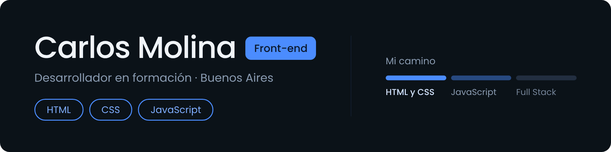

  
  

## Sobre mí

Soy Carlos, de Buenos Aires. Soy estudiante de la Tecnicatura Universitaria en Programación en la UTN y, en paralelo, aprendo desarrollo web de forma autodidacta. Mi meta es trabajar como desarrollador Full Stack.

- Aprendo con freeCodeCamp y llevo lo que aprendo a proyectos propios.
- Me importan los detalles: accesibilidad, diseño responsive y código prolijo.
- Ahora estoy aprendiendo JavaScript para la v2 de TaskFlow.

## Tecnologías

  
  
  
  
  
  

## Proyecto destacado

### TaskFlow

Lista de tareas con estética de vidrio, modo claro y oscuro y diseño responsive. Hecha con HTML y CSS, probada en celular, tablet y escritorio.

  
  

